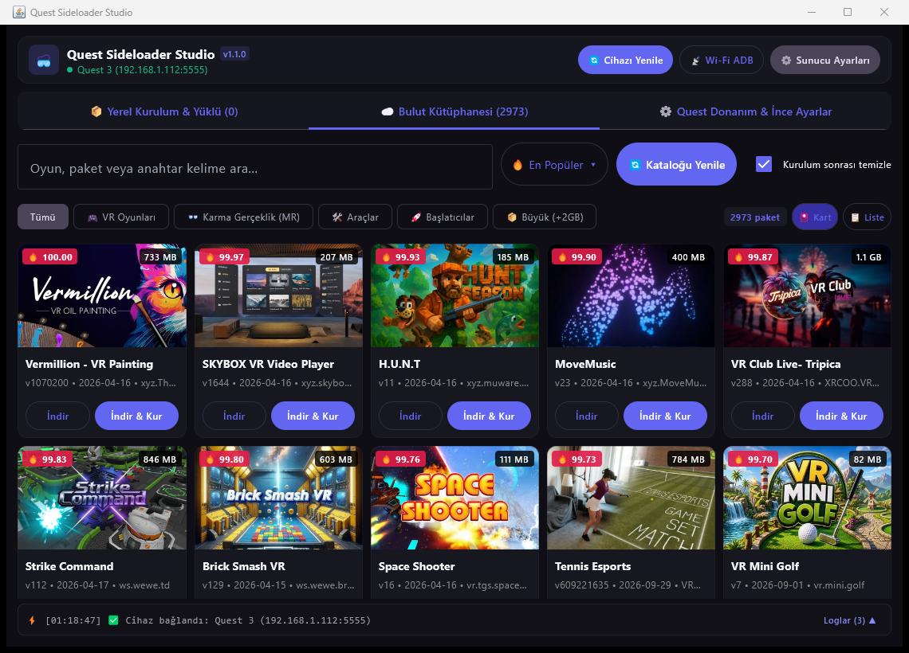

# 🥽 Quest Sideloader Studio

<div align="center">


**Meta Quest (Quest 3, Quest 2, Quest Pro) ve Android tabanlı bağımsız VR gözlükleri için modern, minimalist ve yüksek performanslı sideloading, kütüphane yöneticisi ve donanım ince ayar istasyonu.**

[Özellikler](#-özellikler) • [Ekran Görüntüleri](#-ekran-görüntüleri) • [Hızlı Başlangıç](#-hızlı-başlangıç) • [Kurulum & Derleme](#-kaynaktan-derleme) • [Teknoloji Yığını](#-teknoloji-yığını)

---

### 📸 Ekran Görüntüsü


</div>

---

## ✨ Özellikler

### ☁️ Akıllı Bulut Kütüphanesi
- **2,800+ Oyun ve Uygulama:** Mirror sunucu kataloğunu anında çeker ve yerel önbellekte saklar.
- **Kapak Görselleri (Thumbnails):** 2,800+ oyun kapağını anlık olarak yerel disk önbelleğinden yükleyen asenkron görsel motoru.
- **Çok Kriterli Sıralama:**
  - 🔥 **En Popüler:** İndirme ve popülerlik skoruna göre sıralama.
  - 🔤 **İsim (A-Z / Z-A):** Alfabetik sıralama.
  - 📦 **Boyut (En Büyük / En Küçük):** Dosya boyutuna göre sıralama.
  - 🕒 **Son Güncellenen:** En yeni eklenen veya güncellenen paketleri öne çıkarma.
- **Kategori Filtreleri:** VR Oyunları, Karma Gerçeklik (MR), Araçlar (Utility), Özel Başlatıcılar (Launchers) ve +2GB büyük yapımlar.

### ⬇️ Kesintisiz İndirme & Otomatik Kurulum (Sideloading)
- **Dayanıklı Çok Parçalı İndirme:** Bağlantı kesilse dahi kaldığı bayttan devam edebilen resumable HTTP indirme akışı.
- **Otomatik Arşiv Çözme:** Çok parçalı 7z arşivlerini (`.7z.001`, `.7z`) arka planda doğrular ve açar.
- **Tek Tıkla APK + OBB Kurulumu:** Cihaz modeline bakılmaksızın APK'yı kurar ve OBB verilerini `Android/obb/<paket>` klasörüne otomatik taşır.
- **Temizlik Modu:** Kurulum tamamlandıktan sonra diskte yer kaplamaması için geçici indirme arşivlerini isteğe bağlı otomatik temizler.

### 📊 Modern İndirme Paneli & Katlanabilir Canlı Konsol
- **Yüzen İndirme Kartı (Download Dock):**
  - İndirilen dosya adı, yüzdelik ilerleme çubuğu (`LinearProgressIndicator`), indirilen / toplam MB ve anlık durum mesajı.
  - İndirmeyi duraklatma ve devam ettirme butonları.
- **Minimalist Katlanabilir Konsol:**
  - Ekranı kaplamayan tek satırlık canlı durum bildirim çubuğu.
  - İhtiyaç duyulduğunda tek tıkla açılabilen renk kodlu (hata, başarı, indirme) terminal çekmecesi.

### ⚙️ Quest Donanım & İnce Ayarlar (VR Tweaks)
- **Ekran Yenileme Hızı:** Quest panelini doğrudan **72 Hz, 80 Hz, 90 Hz veya 120 Hz** modlarına geçirme.
- **Doku Çözünürlüğü (Texture Resolution):** Göz içi render çözünürlüğünü **1536p, 2048p veya Quest 3 için Ultra 2560p** seviyesine çıkarma (daha net ve keskin görüntü).
- **Yakınlık Sensörü (Proximity Sensor):** Gözlüğü kafanızdan çıkardığınızda ekranın kapanmasını ve arka plandaki indirme/kurulumların yarıda kalmasını önleme.
- **Kablosuz ADB (Wi-Fi):** USB kablosu takılıyken tek tıkla kablosuz ADB modunu aktifleştirerek kablosuz kullanıma geçiş.

### 💾 Yedekleme & Kaldırma
- Cihazınızda yüklü olan 3. parti oyun ve uygulamaları listeler.
- Oyun save dosyalarını (`Android/data/<paket>`) tek tıkla bilgisayara yedekler.
- İstenmeyen oyunları cihazdan temiz bir şekilde kaldırır.

---

## 🚀 Hızlı Başlangıç

### Hazır Portable Sürüm
Uygulama, çalışması için gereken tüm araçları (`adb`, `rclone`, `7z`) ve özel JVM çalışma ortamını bünyesinde barındırır. Bilgisayarınıza harici Java veya Android SDK kurmanız gerekmez.

1. [Releases](https://github.com/SamedHOPA/QuestSideloaderStudio/releases) bölümünden son sürümü indirin veya projeyi derleyin.
2. `QuestSideloaderStudio.exe` dosyasını çalıştırın.
3. Quest gözlüğünüzü USB kablosu ile bilgisayara bağlayın ve gözlük içerisinden **USB Hata Ayıklama (USB Debugging)** iznini onaylayın.
4. Sağ üstteki **`⚙️ Sunucu Ayarları`** butonuna tıklayarak mirror sunucu URL'nizi ve şifrenizi girin (veya **`📋 Hızlı JSON Yapıştır`** butonunu kullanın).
5. Kütüphaneden dilediğiniz oyunu seçip **`İndir & Kur`** butonuna basın!

---

## 🛠️ Kaynaktan Derleme

Proje Kotlin ve Compose Multiplatform tabanlı Gradle yapısına sahiptir.

### Gereksinimler
- JDK 17 veya üzeri
- Windows 10 / 11 (x64)

### Komutlar
```powershell
# Depoyu klonlayın
git clone https://github.com/SamedHOPA/QuestSideloaderStudio.git
cd QuestSideloaderStudio

# Geliştirici modunda doğrudan çalıştırma
.\gradlew.bat run

# Bağımsız JAR paketini derleme
.\gradlew.bat jar
```
Derlenen JAR çıktısı `build/libs/QuestSideloaderStudio-1.1.0.jar` konumunda oluşur.

---

## 🧱 Teknoloji Yığını

| Bileşen | Teknoloji |
|---|---|
| **Dil** | [Kotlin 1.9.22](https://kotlinlang.org/) |
| **Arayüz (UI)** | [Compose Multiplatform 1.6.0 Desktop (Material 3)](https://www.jetbrains.com/lp/compose-multiplatform/) |
| **Görsel Render** | Skiko Desktop (DirectX / Skia AWT) |
| **Asenkron Motor** | Kotlin Coroutines & Flow |
| **Cihaz Köprüsü** | Android Debug Bridge (ADB native process wrapper) |
| **Ağ & Transfer** | Rclone Engine & Resumable HTTP Streaming |
| **Arşiv Motoru** | 7-Zip CLI Wrapper & Java NIO |
| **Güvenlik** | Windows DPAPI (Data Protection API) & AES Güvenli Şifreleme |

---

## 🔒 Güvenlik & Gizlilik
- Kullanıcı API anahtarları Windows DPAPI mekanizması ile şifrelenir ve yalnızca geçerli Windows oturumunda çözülebilir.
- Yerel ağ dışına üçüncü taraf analiz, telemetri veya izleme verisi gönderilmez.

---

## 📄 Lisans
Bu proje kişisel araştırma, yedekleme ve VR optimizasyon araçları kapsamında geliştirilmiştir.
Tüm hakları saklıdır.
